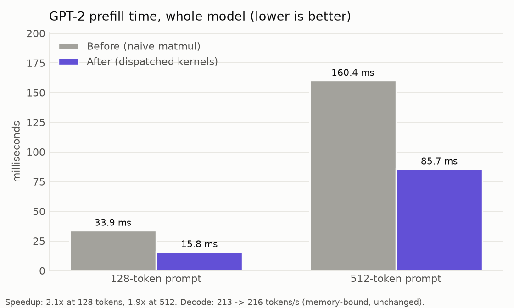
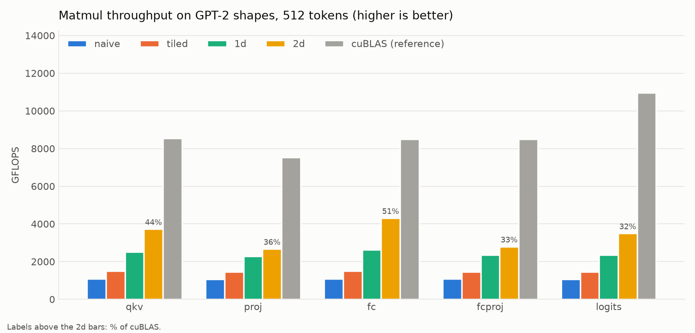

# cuInfer

A GPT-2 (124M) inference engine written from scratch in C and CUDA, with a hand-optimized matrix multiplication kernel.

- **Matmul:** register-tiled kernel up to **4.0x faster** than my naive kernel, reaching **51% of cuBLAS** (fp32, RTX 5060 Laptop GPU).
- **Whole model:** GPT-2 prefill **2.1x faster at 128 tokens** and **1.9x at 512 tokens**.
- **Correctness:** output is bit-identical to the naive kernel and matches a NumPy reference layer by layer.

No PyTorch, cuBLAS or cuDNN in the engine. PyTorch is only used to export the weights and build a reference; cuBLAS is only used in the benchmark, as the yardstick.



## What the engine does

- Loads GPT-2's weights from a flat binary file exported from HuggingFace.
- Runs the full forward pass with my own CUDA kernels: embeddings, 12 transformer blocks (LayerNorm, causal self-attention with a KV cache, MLP with GELU), final LayerNorm and logits.
- Supports prefill (the whole prompt at once) and decode (one token at a time, reusing the KV cache).
- Validated against a NumPy implementation that matches HuggingFace to 7.85e-05: every layer within tolerance, final logits within 7.8e-06 relative error, identical top-5 predictions.

## Why the matmul

I profiled the naive engine at 5, 128 and 512 tokens. Matrix multiplication was 74-90% of the runtime, and one kernel serves every linear layer (QKV, attention output, both MLP layers, logits), so it was the clear target.

## How the matmul got faster

| Kernel | Idea | Speed vs naive (512 tokens) |
|---|---|---|
| naive | One thread per output, reading A and B straight from memory | 1x (~1,050 GFLOPS) |
| tiled | 16x16 tiles staged in shared memory, reused by the whole block | ~1.35x |
| 1d | Each thread computes 8 outputs; each B value is read once into a register and reused 8 times | ~2.3x |
| 2d | Each thread computes an 8x8 patch as an outer product: 16 reads feed 64 multiply-adds | **2.5-4.0x** |

What each step fixed, with evidence:

- **naive** was not waiting on VRAM. Nsight Compute showed VRAM at 0.8% and the L1 load path at 94%, with 62% of stalls on a full load queue: two loads per multiply-add.
- **Tiling** helped less than expected (1.35x). Halving the tile size made it *faster*, which ruled out VRAM; counting machine instructions showed 40 shared-memory reads per 32 multiply-adds. The bottleneck had moved to shared memory.
- **Register tiling** cut shared-memory reads per multiply-add from 1.25 (tiled) to 0.375 (1d) to 0.25 (2d). The 2d kernel runs at only 33% occupancy (register-limited), but each thread has 64 independent multiply-adds per step, so instruction-level parallelism hides the latency. Nsight Compute: one instruction issued every 11.2 cycles per warp vs 40.7 for naive, matching the measured speedup.



Full tables (128 and 512 tokens, every kernel and shape): [results/summary.md](results/summary.md)

## Choosing a kernel per shape

No single kernel wins everywhere, so the engine picks one per matmul (`src/matmul_fast.cuh`), using thresholds I measured:

| Situation | Kernel | Why |
|---|---|---|
| 16 tokens or fewer (decode, short prompts) | naive | Big tiles would be almost empty |
| The 2d kernel would create at least ~20 blocks | 2d | Enough blocks to fill the GPU's 26 SMs |
| Otherwise | 1d | 2d's 128x128 tiles would leave most SMs idle |

## End-to-end results

| | Before (naive matmul) | After | Speedup |
|---|---|---|---|
| Prefill, 128 tokens | 33.9 ms | 15.8 ms | 2.1x |
| Prefill, 512 tokens | 160.4 ms | 85.7 ms | 1.9x |
| Decode | ~213 tokens/s | ~215 tokens/s | unchanged |

- **Why ~2x and not 4x:** attention, which I did not optimize, is now about half the prefill time at 512 tokens (Amdahl's law).
- **Why decode did not change:** with one token, every weight is used once, so decode is memory-bound. My roofline estimate puts the ceiling near 675 tokens/s (about 494 MB of weights per token at ~333 GB/s). The remaining gap is the one-token matmul and about 150 kernel launches per token.

## Repository layout

| Path | Contents |
|---|---|
| `src/model.cu` | The engine: weight loading, all kernels, forward pass, KV cache, validation tests |
| `src/matmul_fast.cuh` | 1d and 2d matmul kernels and the per-shape dispatcher |
| `src/bench_e2e.cuh` | Whole-model timing (prefill and decode) |
| `src/loader.c` | Standalone checker for the weights file format |
| `bench/bench_matmul.cu` | Kernel benchmark: every kernel against cuBLAS on GPT-2's real shapes |
| `export/` | Weight export, the NumPy reference model, the oracle generator, and experiments probing GPT-2's internals |
| `phase0/` | CUDA warm-up experiments: bandwidth, coalescing, warp divergence, async timing |
| `results/` | Raw benchmark outputs, summary tables and charts |
| `plot_results.py` | Builds the tables and charts in `results/` |

## Build and run

Requirements: an NVIDIA GPU, the CUDA toolkit, and Python 3. Tested on an RTX 5060 Laptop GPU with CUDA 13.3 under WSL2.

```bash
git clone https://github.com/0xshreyas/cuInfer.git
cd cuInfer
python3 -m venv venv && source venv/bin/activate
pip install -r requirements.txt

# 1. export GPT-2's weights and build the reference outputs
cd export
python3 export_weights.py
python3 create_oracle.py
cd ..

# 2. build the engine and the benchmark
make

# 3. run the engine: validation tests, profile, end-to-end timing
cd src
./model ../export/gpt2_124m.bin

# 4. benchmark every matmul kernel against cuBLAS (argument = number of tokens)
cd ../bench
./bench_matmul 512
```

## What I learned

- Measure before optimizing: profiling pointed at matmul, and the profiler and instruction counts kept correcting my assumptions about *why* each version was slow.
- Every optimization moves the bottleneck: VRAM, then shared memory, then latency and occupancy.
- Occupancy is not the goal. My fastest kernel runs at 33% occupancy because each thread has enough independent work.
- The best kernel depends on the shape. Big tiles win on big matrices and lose badly on small ones and on decode.
- End-to-end gains are capped by what you did not optimize.

## Future work

- Fix the 2d kernel's shared-memory bank conflicts (the profiler estimates ~21%) and make its stores coalesced.
- Add the tiled kernel to the dispatcher for mid-size prompts (it wins around 32 tokens).
- Speed up decode: a matrix-vector kernel, CUDA Graphs to cut launch overhead, kernel fusion.
- A fused attention kernel, now the largest remaining cost at long prompts.

## References

- Simon Boehm, *How to Optimize a CUDA Matmul Kernel for cuBLAS-like Performance*: the tiling and register-blocking progression this project follows.
- NVIDIA CUDA samples (`matrixMul`, `matrixMulCUBLAS`): the benchmarking and cuBLAS row-major conventions.
- Andrej Karpathy's GPT-2 work and HuggingFace `transformers`: the model definition used for the weights and reference.
